

 
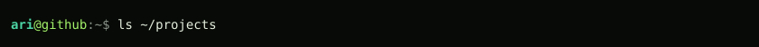 
<a href="https://discord.gg/dSx7Sfu6Pz">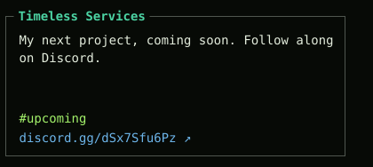</a> 
<a href="https://github.com/AriVenatus/claude-usage-limits">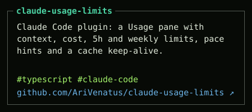</a> 
<a href="https://github.com/AriVenatus/token-radar">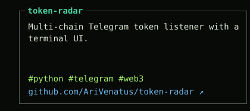</a><a href="https://zyphex.xyz/">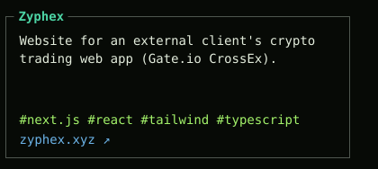</a> 
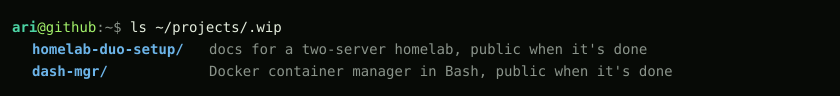 
 
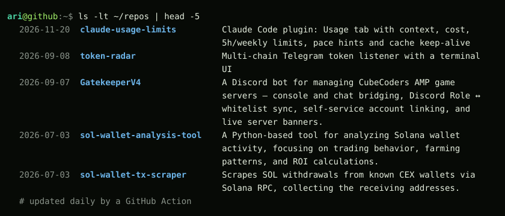 
<a href="mailto:arivenatus@gmail.com">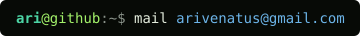</a> 
 
<a href="https://discord.gg/timelesscity">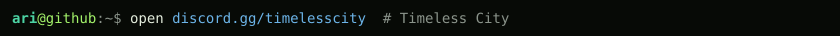</a> 

