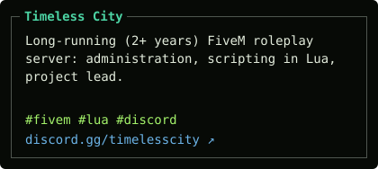
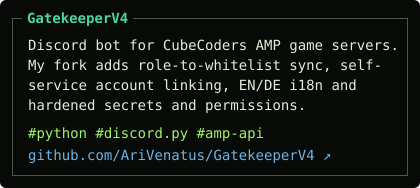
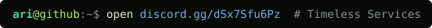

### `$ ls ~/projects`

<p>
<a href="https://discord.gg/timelesscity"></a>
<a href="https://discord.gg/dSx7Sfu6Pz"></a>
<a href="https://github.com/AriVenatus/GatekeeperV4"></a>
<a href="https://github.com/AriVenatus/claude-usage-limits"></a>
<a href="https://github.com/AriVenatus/token-radar"></a>
<a href="https://zyphex.xyz/"></a>
</p>

```
$ ls ~/projects/.wip
homelab-duo-setup/   docs for a two-server homelab, public when it's done
dash-mgr/            Docker container manager in Bash, public when it's done
```

### `$ tree ~/skills`

```
~/skills
├── infra
│   ├── linux           debian | ubuntu (server, xubuntu, lubuntu) | fedora | raspberry pi os | wsl2
│   ├── windows         windows server | active directory (basics)
│   ├── virtualization  hyper-v | proxmox (basics)
│   ├── containers      docker | compose v2
│   ├── network         caddy | tailscale (acls) | adguard home dns | cloudflare tunnel | iot segmentation
│   ├── storage         lvm thin provisioning | mdadm raid1 | rclone backups
│   ├── identity        authentik sso | vaultwarden
│   ├── monitoring      uptime kuma | beszel | diun
│   └── game servers    cubecoders amp | fivem
├── security
│   ├── zero-trust access, no port forwarding
│   ├── secrets management | default-deny firewalling (iptables)
│   ├── http security headers | code audits
│   └── prompt-injection testing for ai agents
├── dev
│   ├── scripting       bash | powershell | python
│   ├── web             next.js | svelte 5 | typescript | node.js | tailwind
│   ├── game            lua (fivem)
│   └── ai              self-taught: local llms (ollama) | quantization trade-offs (gguf, vram)
│                       claude code plugins | agent tooling
├── docs
│   └── runbooks | troubleshooting guides | markdown doc sites
└── web3
    └── on-chain analysis | blockscout api | dune | solana rpc
```

### `$ ls -lt ~/repos`

<!-- now:start -->
```
$ ls -lt ~/repos | head -5
2026-11-20  claude-usage-limits         Claude Code plugin: Usage tab with context, cost, 5h/week…
2026-09-08  token-radar                 Multi-chain Telegram token listener with a terminal UI
2026-09-07  GatekeeperV4                A Discord bot for managing CubeCoders AMP game servers — …
2026-07-03  sol-wallet-analysis-tool    A Python-based tool for analyzing Solana wallet activity,…
2026-07-03  sol-wallet-tx-scraper       Scrapes SOL withdrawals from known CEX wallets via Solana…
```
<!-- now:end -->
<sub>Updated daily by a GitHub Action.</sub>

### `$ cat contact`

<p>
<a href="mailto:arivenatus@gmail.com"></a><br>
<a href="https://discord.gg/dSx7Sfu6Pz"></a><br>
<a href="https://discord.gg/timelesscity"></a>
</p>
